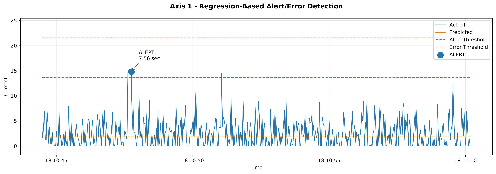
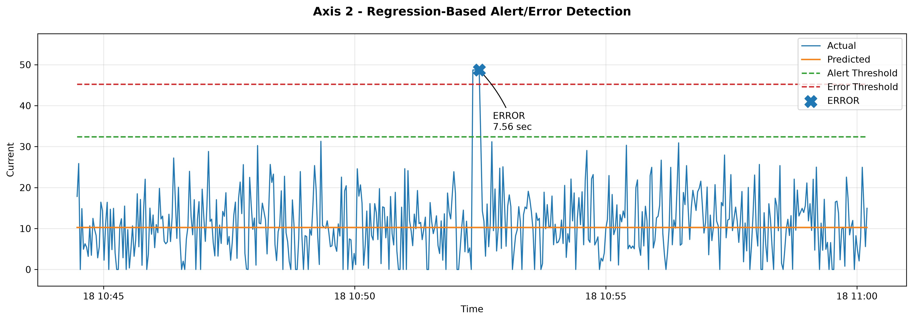

# Practical Lab 1 - Predictive Maintenance with Linear Regression-Based Alerts

**Student:** Zeynep Ozdemir 
**Student ID:** 9045142 
**Course:** CSCN8010 - Foundation Machine Learning Framework  

## Project Summary

This project implements a predictive maintenance pipeline using PostgreSQL, synthetic streaming data, and Linear Regression.

Historical robot measurements are used to train eight separate regression models:

`Time → Axis #1–#8`

For each axis, the model predicts the expected current. The difference between the actual and predicted current is calculated as a residual and used to detect abnormal behavior.

Synthetic test data is streamed into PostgreSQL and monitored for sustained ALERT and ERROR conditions.

## Regression and Alert Rules

Residuals are calculated as:

`Residual = Actual Current - Predicted Current`

Thresholds are determined independently for each axis:

- **MinC:** 95th percentile of positive residuals
- **MaxC:** 99th percentile of positive residuals
- **T:** 6 seconds

Detection rules:

- **NORMAL:** Residual < MinC
- **ALERT:** Residual >= MinC continuously for at least 6 seconds
- **ERROR:** Residual >= MaxC continuously for at least 6 seconds

The 6-second persistence requirement helps reduce false alarms caused by short-lived spikes.

## Synthetic Streaming and Monitoring

Synthetic test data is stored in:

`data/generated/synthetic_test.csv`

The streaming script:

`src/stream_synthetic_data.py`

inserts the synthetic records sequentially into the PostgreSQL `synthetic_stream` table.

The monitoring logic is implemented in:

`src/monitoring.py`

The system evaluates all 500 synthetic records across all eight robot axes.

## Results

The final monitoring run detected two confirmed maintenance events:

| Axis | Event | Residual | Duration |
|---|---|---:|---:|
| Axis 1 | ALERT | 12.80 | 7.56 sec |
| Axis 2 | ERROR | 38.44 | 7.56 sec |

Confirmed events are stored in:

`logs/maintenance_events.csv`

## Result Plots

### Axis 1 - Confirmed Alert

### Axis 1 - Confirmed Alert



### Axis 2 - Confirmed Error



The plots show the actual current, regression prediction, Alert/Error thresholds, confirmed event, and event duration.

## Setup Instructions

### 1. Clone the Repository

```bash
git clone <YOUR_GITHUB_REPOSITORY_URL>
cd Practical-Lab-1--Predictive-Maintenance-Linear-Regression-Based-Alerts
```

### 2. Create a Virtual Environment

```bash
python -m venv .venv
```

### 3. Activate the Virtual Environment

On Windows:

```bash
.venv\Scripts\activate
```

### 4. Install Dependencies

```bash
pip install -r requirements.txt
```

### 5. Configure the PostgreSQL Database Connection

Create a `.env` file in the project root directory:

```env
DATABASE_URL=your_postgresql_connection_string
```

The project uses PostgreSQL to store both historical training data and synthetic streaming data.

Do not commit the `.env` file to GitHub.

### 6. Prepare the Training Data

The cleaned training dataset is uploaded to PostgreSQL and used to train the Linear Regression models.

If needed, run:

```bash
python src/upload_training_data.py
```

### 7. Generate Synthetic Test Data

Generate the synthetic testing dataset:

```bash
python src/generate_synthetic_data.py
```

The generated file is saved as:

```text
data/generated/synthetic_test.csv
```

### 8. Stream Synthetic Data to PostgreSQL

Run the streaming simulation:

```bash
python src/stream_synthetic_data.py
```

The script inserts the synthetic records sequentially into the PostgreSQL `synthetic_stream` table with a short delay between records.

### 9. Run the Predictive Maintenance Notebook

Open:

```text
notebooks/predictive_maintenance.ipynb
```

and run the notebook cells in order.

The notebook:

- loads the training data from PostgreSQL,
- trains eight Linear Regression models,
- analyzes residuals,
- determines Alert and Error thresholds,
- monitors the synthetic test data,
- confirms sustained ALERT and ERROR events,
- logs maintenance events,
- and generates the final visualizations.

## Main Technologies

- Python
- pandas
- NumPy
- scikit-learn
- Matplotlib
- PostgreSQL
- psycopg2
- python-dotenv
- Jupyter Notebook

## AI Assistance

ChatGPT by OpenAI was used to assist with debugging, code organization, visualization, and documentation.

All code was executed, tested, reviewed, and integrated by the student.